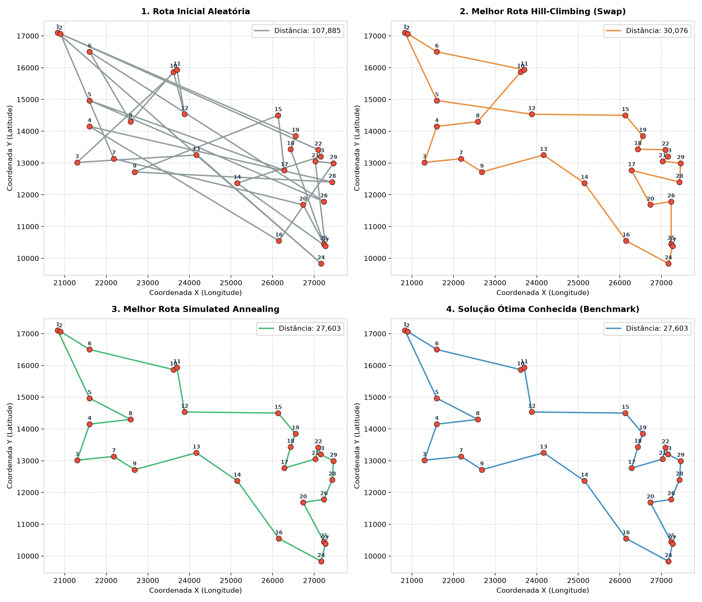
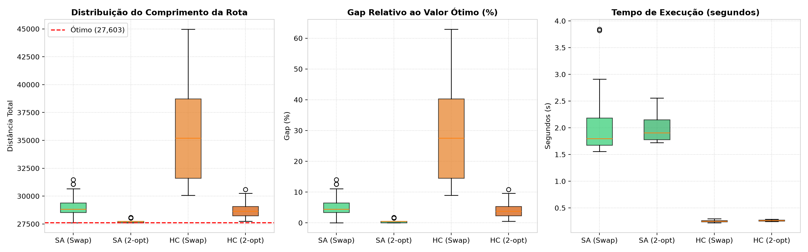
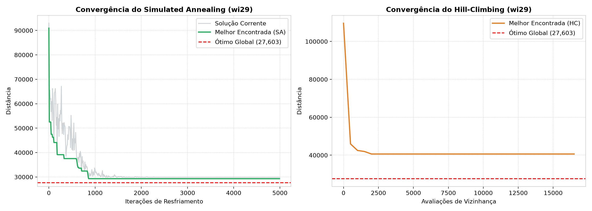
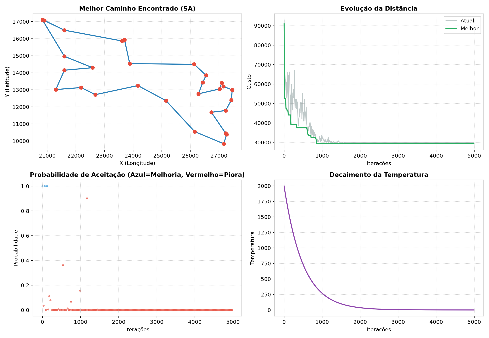

# Atividade: Resolução do Problema do Caixeiro Viajante (TSP)
## Comparação entre Simulated Annealing (SA) e Hill-Climbing (HC)

Este repositório contém a implementação, experimentação e análise comparativa entre as meta-heurísticas **Simulated Annealing (SA)** e **Hill-Climbing (HC)** para resolver a instância clássica **Western Sahara (`wi29.tsp`)** com 29 cidades.

- **Instância:** `wi29.tsp` (29 localidades no Saara Ocidental)
- **Custo Ótimo Comprovado:** `27.603` (TSPLIB / Concorde)
- **Notebook Principal (Template Colab Completo):** [`Atividade_TSP_SA_HC.ipynb`](Atividade_TSP_SA_HC.ipynb)
- **Notebook Dedicado (Apenas TSP):** [`Atividade_TSP_Simulated_Annealing_vs_Hill_Climbing.ipynb`](Atividade_TSP_Simulated_Annealing_vs_Hill_Climbing.ipynb)

---

## 🚀 Como Abrir no Google Colab

Clique diretamente em um dos botões abaixo para abrir o notebook no Google Colab em um clique:

| Versão | Descrição | Link Direto Colab |
| :--- | :--- | :--- |
| **Notebook Principal** | Contém o template original da aula, respostas dos exercícios teóricos e a atividade completa do TSP. |  |
| **Versão Dedicada** | Focada exclusivamente na formulação e resolução experimental do TSP Western Sahara. |  |

---

## 📊 Resultados Experimentais (30 Execuções Independentes)

| Algoritmo | Operador de Vizinhança | Melhor Custo (Mín) | Custo Médio | Desvio Padrão (Custo) | Pior Custo (Máx) | Gap Médio (%) | Tempo Médio (s) |
| :--- | :---: | :---: | :---: | :---: | :---: | :---: | :---: |
| **Simulated Annealing** | **2-Opt** | **27.603** *(Ótimo)* | **27.734,6** | **159,62** | **28.084** | **0,48%** | ~1,66s |
| **Simulated Annealing** | **Swap** | **27.603** *(Ótimo)* | **29.060,8** | **966,24** | **31.467** | **5,28%** | ~1,55s |
| **Hill-Climbing Simples** | **2-Opt** | 27.750 | 28.814,5 | 740,07 | 30.587 | 4,39% | **0,27s** |
| **Hill-Climbing Simples** | **Swap** | 30.076 | 35.659,4 | 4.340,92 | 44.973 | 29,19% | **0,25s** |
| **Hill-Climbing Restart** | **2-Opt (30x)** | **27.603** *(Ótimo)* | **27.641,5** | **89,30** | **28.022** | **0,14%** | ~1,54s |

*Nota:* $\text{Gap (\%)} = \frac{\text{Custo} - \text{Ótimo}}{\text{Ótimo}} \times 100\%$, onde $\text{Ótimo} = 27.603$.

---

## 🗺️ Visualização das Rotas Encontradas

Comparação entre a rota inicial aleatória, a melhor solução do Hill-Climbing, o circuito ótimo encontrado pelo Simulated Annealing e o benchmark de referência:

---

## 📈 Boxplots Estatísticos e Convergência

### Distribuição de Custo, Gap (%) e Tempo de Execução:

### Curvas de Convergência Dinâmica:

### Painel Instrumentado do Simulated Annealing (Colab Dashboard):

---

## 🧠 Principais Conclusões

1. **Qualidade da Solução:** O **Simulated Annealing** encontrou a rota ótima exata de comprimento **27.603** (Gap = 0,00%). O Hill-Climbing com Swap estagnou com gap médio de **29,19%**, chegando a soluções de pior caso com gap de **62,9%**.
2. **Tempo de Execução:** O Hill-Climbing finaliza mais rápido (~0,25s) unicamente devido à **estagnação prematura** (não possui mecanismo para escapar de mínimos locais). O SA emprega ~1,85s a 2,0s de forma altamente eficiente para explorar e refinar o espaço de busca.
3. **Robustez:** O desvio padrão de apenas **159,62** no `SA (2-Opt)` confirma sua consistência e independência da rota inicial. Em contrapartida, o `HC (Swap)` apresentou desvio de **4.340,92**, demonstrando extrema dependência da semente inicial.
4. **Impacto do 2-Opt:** O operador 2-Opt foi decisivo para acelerar a eliminação de cruzamentos de arestas no espaço euclidiano, melhorando o desempenho de ambos os algoritmos.
